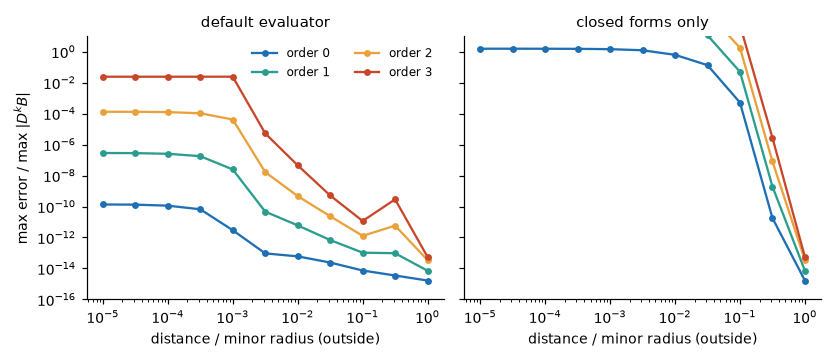
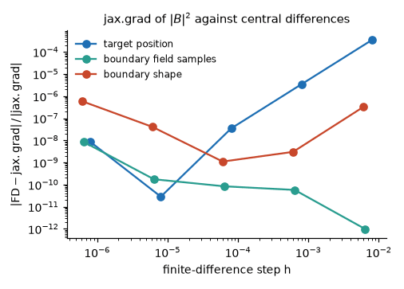

Derivatives and gradients
=========================

Field derivatives up to third order
-----------------------------------

``B_and_derivatives_accurate_xyz(xyz, order=k)`` returns ``(values, estimate)`` where ``values`` is a tuple
of ``k + 1`` arrays: ``B``, ``dB_i/dx_j``, ``d2B_i/dx_j dx_k`` and ``d3B_i/dx_j dx_k dx_l``, shapes
``(n, 3)``, ``(n, 3, 3)``, ``(n, 3, 3, 3)`` and ``(n, 3, 3, 3, 3)``. One traversal of the sources returns
every order.

.. code-block:: python

   (B, gradB, hessB, thirdB), estimate = field.B_and_derivatives_accurate_xyz(points, order=3, tol=1e-8)

The ``k``-th derivative is accepted from the closed forms at ``100**k * tol`` (scaled by the surface
half-extent), and sent to the graded rule otherwise. ``route_order`` chooses which orders take part in
that decision; ``route_order=0`` makes the routing that of ``B`` alone.

Against closed-form (automatic) derivatives of a current loop, the default keeps every order accurate
from one minor radius down to a few thousandths. Inside ``1e-3`` of the half-extent each derivative is
continued from that distance along the normal, and the error of order ``k`` is set by the continuation,
which grows with ``k``: higher orders are usable but looser there (the estimate follows). The closed forms
alone lose all orders within a tenth of a minor radius.

Automatic differentiation
-------------------------

Every evaluator is a JAX function of the targets and of the data (``gamma``, ``B_total``): ``jax.grad``,
``jvp``, ``jacfwd``, ``vmap`` and ``jit`` all work. Reverse mode through the near-surface rule is
rematerialized chunk by chunk, so its memory does not grow with the number of nodes. The routing
decision and the grading centre are held fixed under differentiation, so the derivative is that of the
returned field.

The figure checks ``jax.grad`` of ``sum(|B|^2)`` against central finite differences in a random
direction, with respect to the target position, the boundary field samples and the boundary shape. The
agreement (``1e-9`` or better at the best step) is limited by the finite differences themselves.

For on-surface calls that must be differentiable in the surface coordinates, freeze the geometry-dependent
choices once::

    plan = field.plan_surface_precision(digits=6)
    B_surface = field.B_plasma_on_surface(precision=plan)

The runnable example :doc:`tutorial_getting_started` ends with a ``jax.grad`` check against finite
differences. Discontinuous diagnostics (Poincare points, wall hits) remain non-differentiable
(:doc:`differentiability`).
