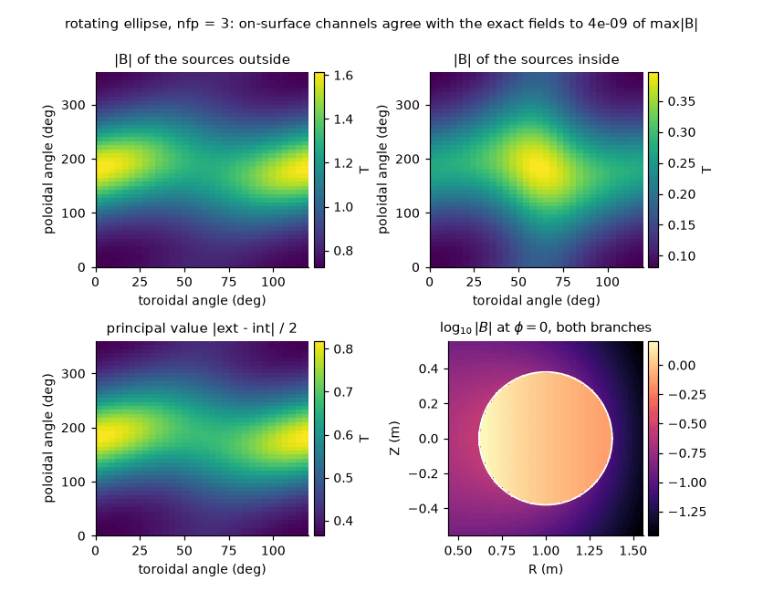

Getting started
===============

The package turns the total magnetic field ``B`` sampled on a closed surface into the field
of the sources on either side of it. For a plasma boundary this is the field the plasma
currents make outside the boundary (the *internal* branch: the sources are inside), and the
field of the coils and other external sources inside it (the *external* branch).

Install and check
-----------------

.. code-block:: bash

   python -m pip install --upgrade virtual-casing-jax
   JAX_ENABLE_X64=true python -c "import virtual_casing_jax"

Use double precision (``JAX_ENABLE_X64=true`` or ``jax.config.update("jax_enable_x64", True)``);
the default ``digits=8`` is not reachable in single precision.

The data
--------

``VmecSurfaceFieldData`` holds one field period of the boundary ``gamma`` and the total field
``B_total`` on it, both ``(3, nphi, ntheta)`` in Cartesian components (see :doc:`parameters`).
From a VMEC equilibrium use VMEX, which builds it for you::

    from vmex import read_wout
    from vmex.core.virtual_casing import surface_field_data_from_wout
    from virtual_casing_jax import ExteriorFieldConfig, VirtualCasingExteriorField

    surface = surface_field_data_from_wout(read_wout("wout_example.nc"), nphi=32, ntheta=32)
    field = VirtualCasingExteriorField(surface, ExteriorFieldConfig())

The runnable example below needs nothing but this package: it samples a rotating-ellipse
boundary carrying the fields of point dipoles inside and outside it, so the exact answer is
known everywhere.

.. literalinclude:: ../examples/exterior_field_tutorial.py
   :language: python

Evaluate
--------

.. code-block:: python

   points = jnp.array([[1.8, 0.0, 0.0], [1.0, 0.0, 0.2]])
   B, estimate = field.B_plasma_xyz(points, return_estimate=True)
   gradB = field.gradB_plasma_xyz(points)           # (n, 3, 3): [t, i, j] = dB_i/dx_j
   B_total = field.B_xyz(points)                    # plasma plus external_B_fn, if one was given

``estimate`` is a relative error estimate per target. It is comparable with ``10**-digits`` and
is conservative: it flags a target whose accuracy it cannot certify, which is how data that are
too coarse for the requested ``digits`` announce themselves (:doc:`tutorial_near_surface`).
Targets may lie at any distance from the surface on either side; the right method is chosen
for each (``near_surface=True``, the default).

What you get
------------

On the surface (top row and bottom left) the three channels of
``VirtualCasingJAX`` are the field of the sources outside (``compute_external_B``, taken from
inside the surface), the field of the sources inside (``compute_internal_B``, taken from
outside) and their half-difference, the principal value
(``compute_principal_value_B``). Off the surface (bottom right) ``B_plasma_xyz`` gives the field of
the sources inside at targets outside and, with ``branch="external"``, the field of the sources
outside at targets inside. :doc:`tutorial_density_contract` has the signs.

Next: :doc:`tutorial_near_surface`, :doc:`tutorial_derivatives`, :doc:`tutorial_gpu`,
:doc:`tutorial_mirror`.
