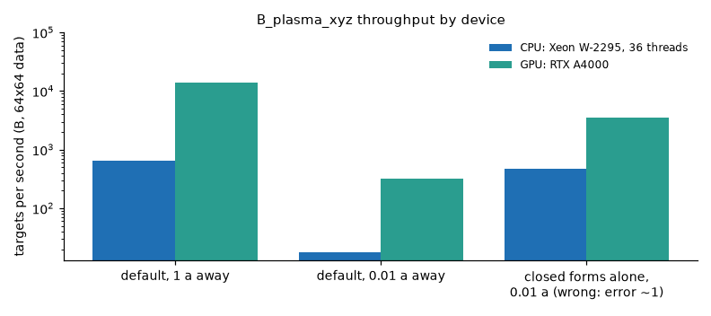

GPU and multi-device use
========================

The code is plain JAX: it runs on whatever device JAX selects, with no option to set. Enable double
precision first (``jax.config.update("jax_enable_x64", True)`` or ``JAX_ENABLE_X64=true``).

Measured with ``docs/make_readme_figures.py measure_speed``: 2000 targets per call, jitted
``B_plasma_xyz`` on ``64 x 64`` samples (``nfp = 3`` rotating ellipse), one NVIDIA RTX A4000 against
the 36 threads of an Intel Xeon W-2295. Both machines were shared with other jobs while measuring, so
read the ratio (about 20 times) rather than the absolute rates. Targets away from the surface cost
the least; targets within a few node spacings pay for their own graded quadrature, 36 to 43 times more per
target on these devices, and are the ones that gain from a GPU.

Practical advice
----------------

* **Batch targets.** Pass ``(n, 3)`` arrays; the evaluators tile the targets and the sources, with
  ``chunk_size`` and ``target_chunk_size`` left at ``"auto"`` (tuned per backend). On an accelerator the graded
  rule evaluates 32 targets per step instead of 4 on a CPU.
* **Compile once.** Wrap repeated calls with the same shapes in ``jax.jit`` (``jax.jit(field.B_plasma_xyz)``);
  the first call compiles, later ones do not. Changing the number of targets recompiles.
* **Memory.** Reverse-mode differentiation recomputes each chunk instead of storing it, so peak memory
  follows the chunk size, not the number of nodes. If a shared GPU runs out, set
  ``XLA_PYTHON_CLIENT_PREALLOCATE=false`` and lower ``target_chunk_size``.
* **Several devices.** ``field.B_xyz_sharded(points)`` splits the target axis over every visible JAX
  device and replicates the (small) surface data; ``devices=[...]`` selects a subset, and a single device
  falls back to ``B_xyz``. It stages the targets through host memory, so use ``B_xyz`` inside an already
  jitted graph, and do not use it for single-point calls.
* **Precision.** ``dtype="float32"`` halves memory and limits every result to single-precision accuracy, so do not
  request more ``digits`` than that. Consumer GPUs have low float64 throughput, which the timings above
  already include.
* **Data resolution, not nodes.** If targets near the surface are too slow for a batch, sample the boundary
  field more finely so the closed forms resolve them, rather than raising ``graded_nodes``
  (:doc:`tutorial_near_surface`).
