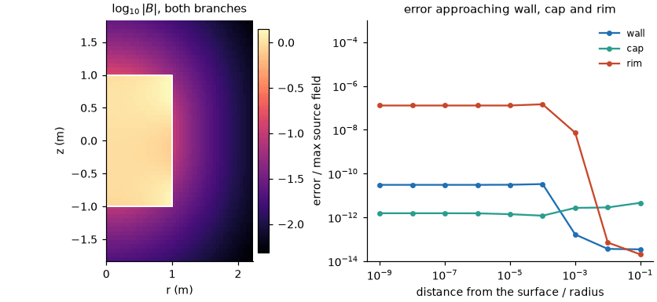
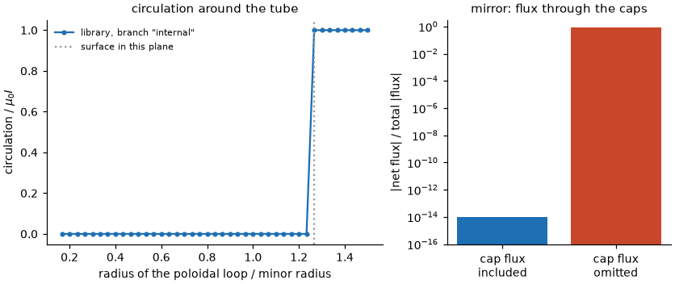

Mirror surfaces
===============

``virtual_casing_jax.mirror`` handles a closed surface that is not a torus: a side wall
``r = radius(z, v)`` closed by a flat disk at each end (topologically a sphere). The theory and the
accuracy table are in :doc:`mirror`; this page is the workflow.

Build the three patches from the total field on the surface, then evaluate::

    from virtual_casing_jax.mirror import MirrorExteriorField, mirror_panels

    panels = mirror_panels(radius, z_min, z_max, side_field, lower_field, upper_field)
    field = MirrorExteriorField(panels)
    assert field.flux_defect() < 1e-8                         # the caps carry the through-flux
    (B, gradB), estimate = field.B_and_derivatives_xyz(points, order=1)

* ``radius(z, v)``: wall radius, star-shaped about the axis, ``v`` the azimuth.
* ``side_field(z, v)``: total ``B`` on the wall, a Cartesian 3-vector.
* ``lower_field(w, v)``, ``upper_field(w, v)``: total ``B`` on the caps at the fraction ``w`` of the rim
  radius (``w = 0`` is the axis).
* The caps are part of the surface. A cap whose through-flux is omitted gives a wrong field, which
  ``flux_defect()`` reports as order one.
* ``branch="internal"`` (default): field of the sources inside, at targets outside.
  ``branch="external"``: field of the sources outside, at targets inside.
* ``nodes``, ``plain_nodes`` and ``cloud`` (:doc:`parameters`) trade node counts for time; the defaults
  reach the accuracy of :doc:`mirror` and rarely need changing.

The runnable example below checks both branches against two point dipoles.

.. literalinclude:: ../examples/mirror_field.py
   :language: python

Left, the field around the cylinder with its caps (the field of the sources inside outside the
surface, of the sources outside inside it). Right, the error of the sources-inside field approaching the
wall, a cap and the rim, against closed-form loop fields; the limits listed in :doc:`mirror` apply
(from inside, keep targets farther than ``1e-3`` of the radius from a rim).

Flux and circulation are the two topological constraints on the data. The net flux through any closed
surface must vanish (right: the mirror's ``flux_defect`` with and without the cap flux). The circulation of the
field of the sources inside around a loop that threads the tube is ``mu0`` times the enclosed current when
the loop is outside the surface and zero when it is inside (left), and the near-surface rule resolves the
step at the surface.
