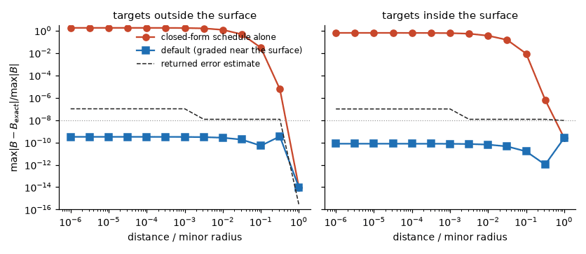
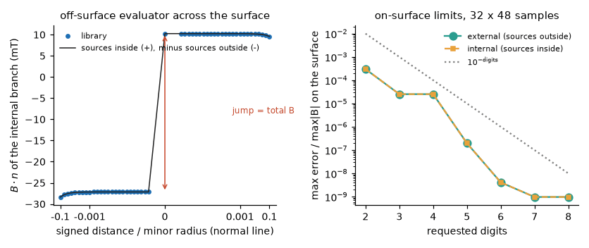

Near-surface accuracy and the error estimate
=============================================

The surface integrals are evaluated with the periodic trapezoid rule over the sampled
boundary. That rule is spectrally accurate until the target comes within a few node spacings
of the surface, where the kernel is nearly singular: its error then grows like ``1/d**(k+1)``
for the ``k``-th derivative. ``VirtualCasingExteriorField`` therefore evaluates each target
twice (a fine and a coarse level of the closed-form sums) and routes it:

* if the two levels agree to ``tol = 10**-digits`` (``100**k * tol`` for the ``k``-th derivative) the
  closed form is kept;
* otherwise the target gets its own quadrature, graded about its nearest point on the surface
  (``graded_nodes``, default at least ``256 x 512``), and within ``1e-3`` of the half-extent the
  jets are Taylor-continued along the normal from that distance, so a target on the surface returns
  the limit from outside.

The figure compares the default with ``ExteriorFieldConfig(near_surface=False)`` against the exact
field, on both sides, from one minor radius to a millionth of it.

The estimate
------------

``return_estimate=True`` returns, per target, a relative error estimate of ``B``. Read it against
``10**-digits``:

* for a target kept on the closed forms it is ``30`` times the squared difference between the
  coarsest and the finest level, scaled by the RMS surface field;
* for a graded target it is the largest of the change from using every second node, the last Taylor
  term (within ``1e-3``), and the spectrum of the sampled field in the top quarter of the samples.

The last term is what bounds the data: with ``n`` samples per direction the field is known only to
its Fourier interpolation error (``6e-4``, ``6e-6`` and ``2e-10`` for ``n = 24, 48, 96`` on the gate
fixture), and no evaluation of the same data does better. In the figure the estimate is flat at about
``1e-7`` because the example samples ``32 x 48`` points per period; the actual error is far below it.
If the estimate exceeds ``10**-digits`` the remedy is more samples of the boundary field, not a larger
``graded_nodes``.

Choosing the options
--------------------

* Leave ``near_surface=True``. Its cost is only paid by targets the closed forms do not resolve.
* ``digits`` is both the accuracy you ask for and the routing threshold; ``digits=6`` sends fewer targets
  to the graded rule than ``digits=10``.
* A target very close to the surface costs more than a far one: about 25 ms against 0.4 ms on a laptop CPU
  at 64 samples per direction. A large batch of near-surface targets is better served by sampling the data
  finer so that the closed forms resolve them.
* The default ``graded_nodes`` is the knee of cost against accuracy. On the ``32 x 48`` fixture, targets at
  ``1e-4`` and ``1e-6`` of the minor radius are wrong by ``2e-4`` with ``(128, 256)`` nodes and ``3e-7`` with
  ``(192, 384)``, reach ``3e-10`` (the data limit) with the default ``(256, 512)``, and gain nothing from
  ``(384, 768)`` or ``(512, 1024)``, which cost two and three times as much (1.3 ms per target on a GPU
  at the default). Farther than ``1e-2`` all of them agree.
* Targets exactly on the surface return the limit from outside. For the on-surface limits from both sides
  use the ``VirtualCasingJAX`` operators (:doc:`tutorial_density_contract`).
* Accuracy and jump across the surface:

Left, the internal-branch field along a normal line: the field of the sources inside outside the surface and
minus the field of the sources outside inside it, with a jump equal to the total field, resolved to a
millionth of the minor radius on both sides. Right, the on-surface limits
against the requested ``digits`` for ``32 x 48`` samples per field period; the error follows ``10**-digits``
until the resolution of the samples is reached.
